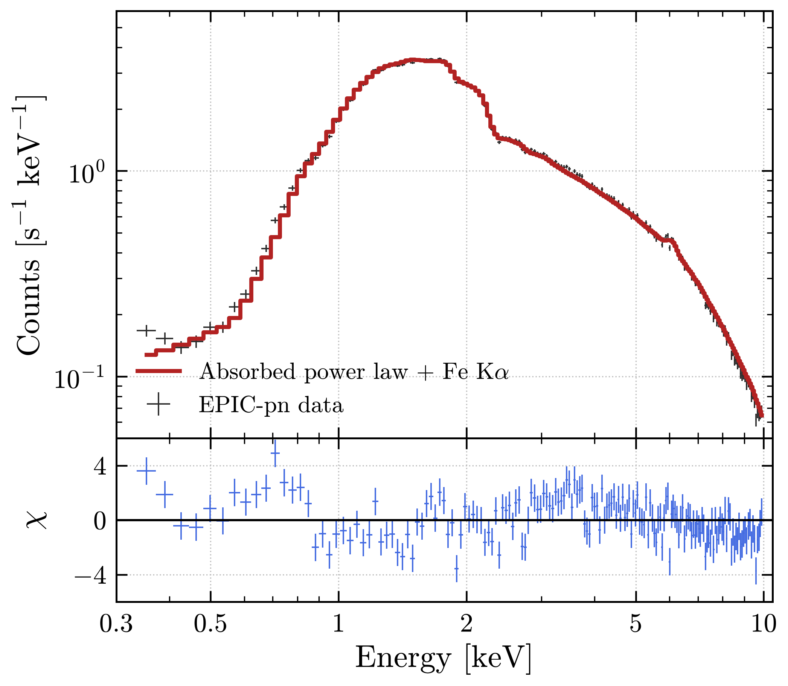
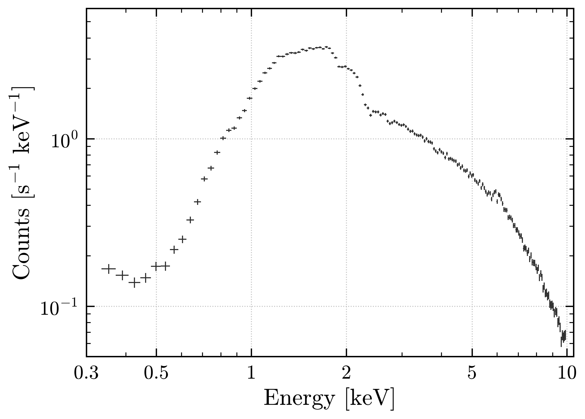
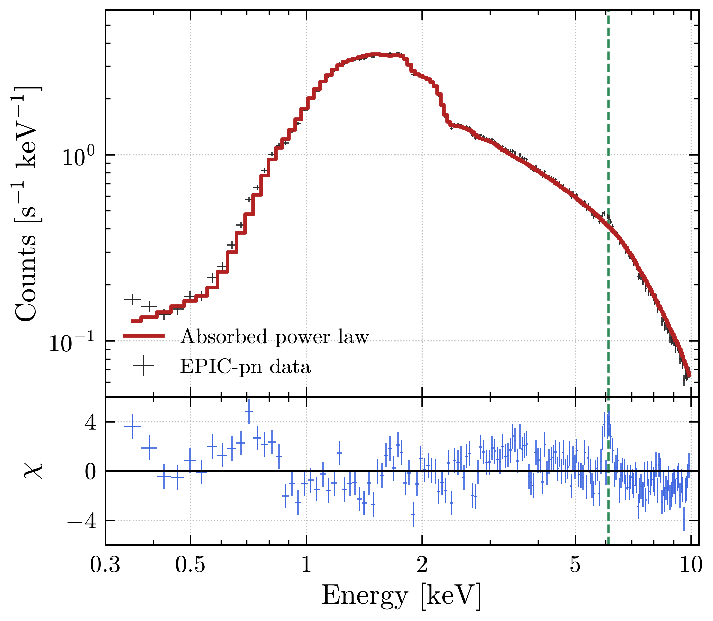
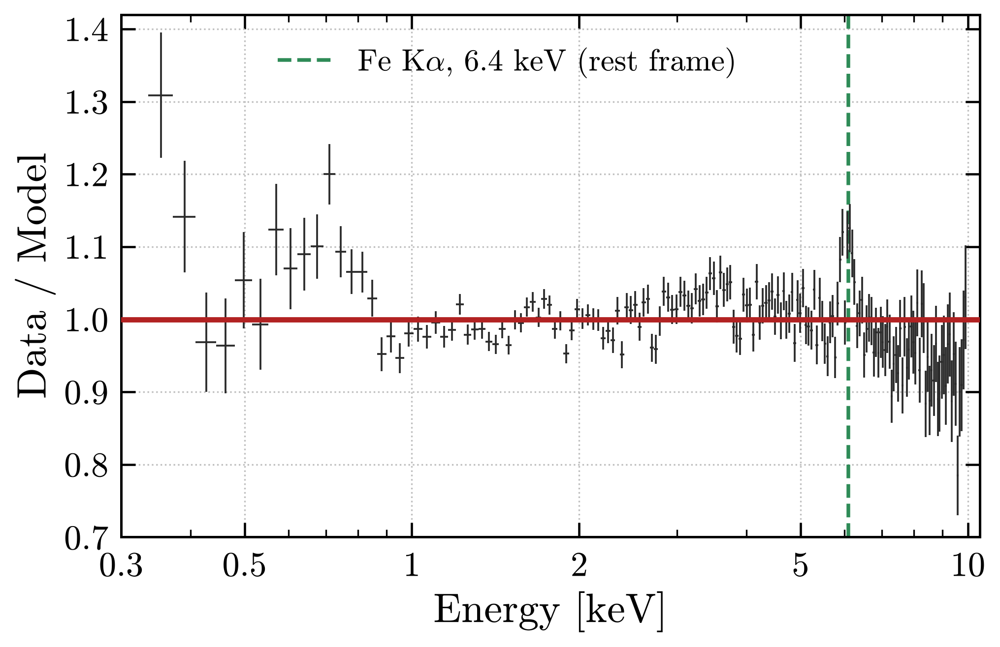
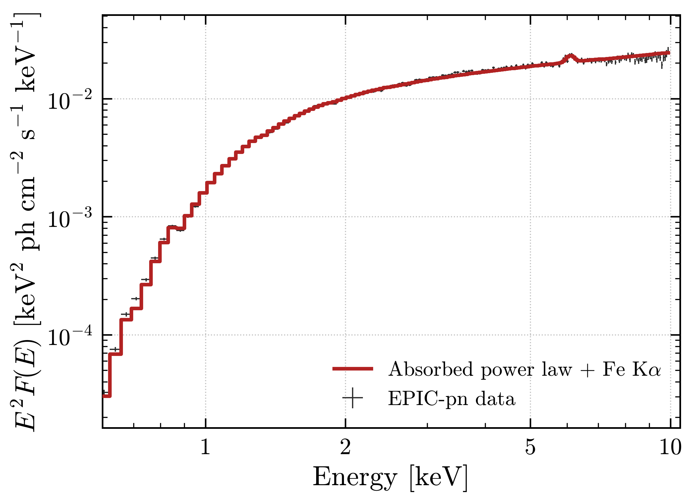
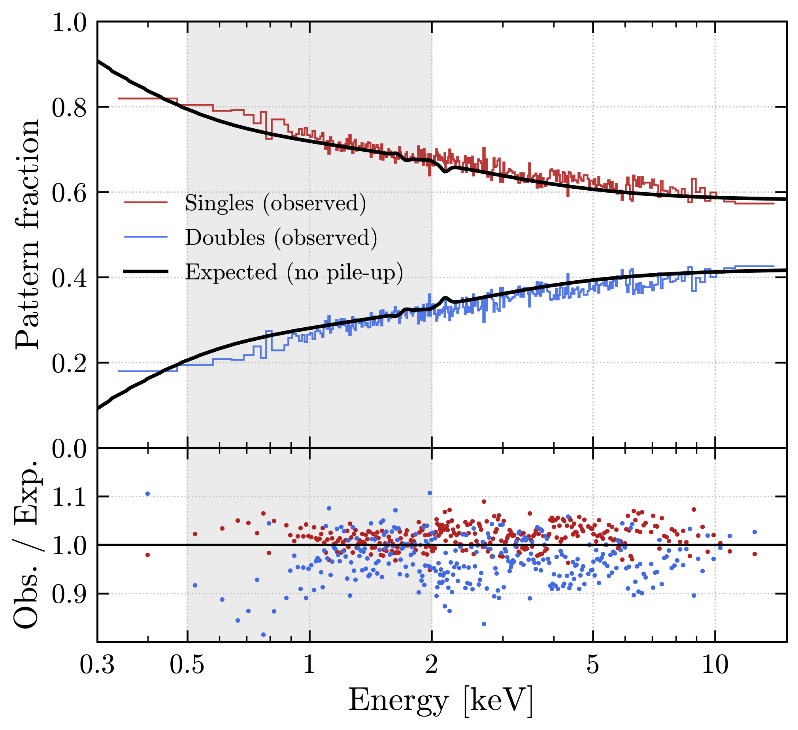
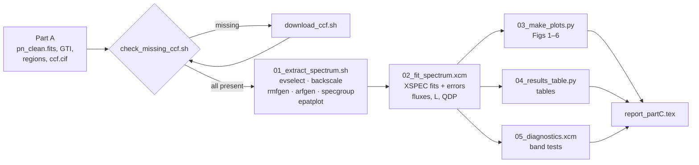

<div align="center">

# X-ray Spectral Analysis of the Radio Galaxy 3C 111
### XMM-Newton EPIC-pn · ObsID 0552180101 · SAS + XSPEC




*EPIC-pn spectrum of 3C 111 fitted with an absorbed power law plus a Gaussian Fe Kα line.*

</div>

---

## Overview

This repository contains the full pipeline for **Part C (X-ray spectral analysis)** of Project 6:
the XMM-Newton observation of the broad-line radio galaxy **3C 111** (*z* = 0.049).

Starting from the cleaned EPIC-pn event list, the good time intervals and the extraction regions of Part A, the pipeline

1. extracts source and background spectra (SAS `evselect`, `backscale`),
2. builds the redistribution matrix and ancillary response (`rmfgen`, `arfgen`),
3. groups the spectrum for χ² statistics (`specgroup`) and checks for pile-up (`epatplot`),
4. fits absorbed power-law models in **XSPEC** and derives N<sub>H</sub>, Γ, normalisation, fluxes, luminosity and flux density with 90 % errors,
5. produces publication-quality PDF figures and LaTeX/Markdown parameter tables in Python,
6. compiles everything into a LaTeX report.

The `calibration/` folder holds the scripts I wrote to diagnose and download the missing
Current Calibration Files (CCFs) that `rmfgen` and `arfgen` needed. They include a downloader that shows how much has been downloaded and how much is left.

---

## Key results

Best-fitting model: `tbabs × (zpowerlw + zgauss)`, 0.3–10 keV, errors at 90 % confidence (Δχ² = 2.706).

| Quantity | Value |
|---|---|
| Column density N<sub>H</sub> | (1.058 ± 0.009) × 10²² cm⁻² |
| Photon index Γ | 1.635 ± 0.008 |
| Power-law normalisation (1 keV) | (1.158 ± 0.013) × 10⁻² ph keV⁻¹ cm⁻² s⁻¹ |
| Fe Kα line energy (rest) | 6.38 ± 0.05 keV |
| Fe Kα equivalent width | 41 ± 12 eV |
| Observed flux, 2–10 keV | 4.59 × 10⁻¹¹ erg cm⁻² s⁻¹ |
| Unabsorbed flux, 2–10 keV | 4.86 × 10⁻¹¹ erg cm⁻² s⁻¹ |
| Luminosity, 2–10 keV (rest) | (2.70 ± 0.01) × 10⁴⁴ erg s⁻¹ |
| Luminosity, 0.3–10 keV (rest) | (4.39 ± 0.02) × 10⁴⁴ erg s⁻¹ |
| Flux density at 1 keV (unabsorbed) | 7.10 µJy |
| χ² / dof (0.3–10 keV) | 388.3 / 171 |
| χ² / dof (3–10 keV) | 108.6 / 106 |

- Adding the Fe Kα line improves the fit by **Δχ² = 45.6 for 3 extra parameters**.
- The net count rate is 8.19 ± 0.01 counts s⁻¹ over 42.2 ks of livetime, and the background is below 1 % of the source.
- There is **no pile-up**: the observed pattern fractions follow the expected ones.
- The remaining χ² excess is confined below 3 keV and comes from X-ray loading at the high count rate (Ballo et al. 2011).
- N<sub>H</sub>, the Fe Kα line and the luminosity agree with Ballo et al. (2011) within the errors.

Full tables: [`results/best_fit_table.md`](results/best_fit_table.md) · Report: [`report/report_partC.pdf`](report/report_partC.pdf)

---

## Figures

| | |
|:---:|:---:|
| <br>**Fig. 1** Source and background spectra | <br>**Fig. 2** Absorbed power-law fit |
| <br>**Fig. 3** Data/model ratio, Fe Kα excess | <br>**Fig. 4** Power law + Fe Kα fit |
| <br>**Fig. 5** Unfolded spectrum (E² F<sub>E</sub>) | <br>**Fig. 6b** Pattern fractions (pile-up check) |

All figures are in `figures/` as vector **PDF** (used in the report) and PNG (for this page).
They follow one plotting style: Computer Modern fonts, inward ticks on all four sides, a dotted grid, units in square brackets and no titles.

---

## Repository structure

```
3C111-XMM-spectral-analysis/
├── README.md                     ← you are here
├── LICENSE
├── CITATION.cff
├── requirements.txt              ← Python dependencies
├── .gitignore                    ← keeps FITS/ODF/CCF data out of git
│
├── config/
│   └── sas_env.sh                ← SAS environment variables (source this first)
│
├── calibration/                  ← CCF diagnosis and download tools
│   ├── README.md
│   ├── check_missing_ccf.sh      ← scans ccf.cif, lists CCFs missing on disk
│   ├── download_ccf.sh           ← downloader with sizes, progress, done/left
│   ├── download_ccf_basic.sh     ← first version (success/failed records)
│   ├── lists/
│   │   ├── ccf_partc_needed.txt  ← 32 CCFs required by the response tasks
│   │   ├── ccf_list_small.txt    ← same, without the 606 MB EPN_FWC_0005
│   │   └── ccf_missing_final.txt ← last two mirror CCFs found by the scan
│   └── logs/                     ← real terminal output of each step
│       ├── 01_cifbuild_unexpected_eof.log
│       ├── 02_missing_ccf_check.log
│       ├── 03_download_ccf_progress.log
│       ├── 04_ccf_cif_scan_and_final_download.log
│       └── 05_responses_generated.log
│
├── scripts/                      ← analysis pipeline (run in order)
│   ├── 01_extract_spectrum.sh    ← spectra, BACKSCAL, RMF, ARF, grouping, epatplot
│   ├── 02_fit_spectrum.xcm       ← XSPEC fits, errors, fluxes, luminosities, QDP export
│   ├── 03_make_plots.py          ← all figures (PDF + PNG)
│   ├── 04_results_table.py       ← parameter tables (Markdown + LaTeX)
│   ├── 05_diagnostics.xcm        ← fit-band tests (0.3–10, 0.5–10, 3–10 keV)
│   └── run_partC.sh              ← runs steps 02 → 04
│
├── results/                      ← numerical output
│   ├── fit_results.txt           ← every fitted value with 90 % bounds
│   ├── best_fit_table.md / .tex
│   ├── best_fit_m1.xcm / best_fit_m2.xcm   ← saved XSPEC models
│   ├── diagnostics.txt
│   ├── epatplot_fractions.csv    ← pattern fractions read from epatplot
│   ├── qdp_fig0*.qdp             ← XSPEC plot data behind Figs 1–5
│   ├── xspec_partC.log, xspec_diagnostics.log
│   └── logs/run_partC_terminal.txt
│
├── figures/                      ← Figs 1–6 (PDF + PNG)
│   └── raw/fig06_epatplot.pdf    ← untouched SAS epatplot output
│
├── report/
│   ├── report_partC.tex          ← LaTeX source (pulls ../figures, ../scripts)
│   └── report_partC.pdf          ← compiled report (24 pages)
│
└── docs/
    ├── workflow.md               ← step-by-step flow and file dependencies
    └── troubleshooting.md        ← errors met during the analysis and their fixes
```

---

## Workflow



---

## Requirements

| Software | Version used | Purpose |
|---|---|---|
| [XMM-Newton SAS](https://www.cosmos.esa.int/web/xmm-newton/sas) | 22.1.0 | extraction and responses |
| [HEASoft / XSPEC](https://heasarc.gsfc.nasa.gov/xanadu/xspec/) | 12.x | spectral fitting |
| Python | ≥ 3.10 | plots and tables |
| `numpy`, `matplotlib`, `astropy`, `pymupdf` | see `requirements.txt` | |
| `curl`, `numfmt` (GNU coreutils) | — | CCF download |
| `pdflatex` | TeX Live | report |

```bash
pip install -r requirements.txt
```

---

## Data layout

The raw data are **not** stored in this repository because they are too large. The scripts expect this layout on disk:

```
~/sas/SPASE/
├── ODF/                 ← observation data files (from the XMM-Newton Science Archive)
├── CCF/                 ← calibration files (filled by calibration/download_ccf.sh)
├── ccf.cif              ← calibration index built in Part A (cifbuild)
└── part_c/              ← working directory = contents of this repository
    ├── pn_clean.fits    ← cleaned pn event list from Part A
    └── 1683_0552180101_SCX00000SUM.SAS
```

The data for ObsID **0552180101** can be downloaded from the [XMM-Newton Science Archive](https://nxsa.esac.esa.int/).
If your folders are elsewhere, edit `config/sas_env.sh` (and the `cd` line at the top of the scripts).

---

## How to reproduce

**0. Set up the environment**
```bash
cd ~/sas/SPASE/part_c
source config/sas_env.sh
```

**1. Check calibration files, download what is missing**
```bash
./calibration/check_missing_ccf.sh
./calibration/download_ccf.sh calibration/lists/ccf_missing.txt   # only if something is missing
./calibration/check_missing_ccf.sh                                # should end with "check done"
```

**2. Extract spectra and build responses**
```bash
bash scripts/01_extract_spectrum.sh
```
Check that `pn_src_grp.pi`, `pn_src.rmf` and `pn_src.arf` exist and that `figures/raw/fig06_epatplot.pdf` was written.

**3. Fit, plot and tabulate**
```bash
bash scripts/run_partC.sh
xspec <<< "@scripts/05_diagnostics.xcm"
```
Check that `grep -c "XSPEC Error" results/xspec_partC.log` returns `0`, then look at `results/fit_results.txt` and `figures/`.

**4. Build the report**
```bash
cd report && pdflatex report_partC.tex && pdflatex report_partC.tex
```

---

## Calibration files: what happened

`rmfgen` and `arfgen` need many CCFs that Part A never used, and they stop at the first missing one:

```
Could not open file 'EPN_TIMECORR_0011.CCF' for reading in: ...
```

Getting past this took four steps. The real terminal output of each step is in [`calibration/logs/`](calibration/logs).

1. **Rebuilding the index failed.** `cifbuild` stopped with `UnexpectedEOF` because the ODF summary file copied into `part_c/` was truncated. The Part A `ccf.cif` was built for the observation date, so I reused it.
2. **Missing-file diagnosis.** I checked the required list against the CCF folder, which flagged 23 missing files.
3. **Download with progress.** `download_ccf.sh` skips files already present, asks the server for each size, then prints per-file progress and a running total (`overall: 279MB of 279MB, 1857s elapsed, 15/15 files`). I left out `EPN_FWC_0005.CCF` (606 MB) because the spectra do not need it.
4. **Full index scan.** `check_missing_ccf.sh` extracted all 129 CCF names from `ccf.cif` and found the last two missing mirror files (`XRT3_XAREAEF_0014`, `XRT3_XENCIREN_0003`). After downloading them, the responses were generated.

More detail is in [`calibration/README.md`](calibration/README.md) and [`docs/troubleshooting.md`](docs/troubleshooting.md).

---

## References

- Ballo, L. et al. 2011, MNRAS, 418, 2367: *The high-energy view of the broad-line radio galaxy 3C 111*
- Wilms, J., Allen, A. & McCray, R. 2000, ApJ, 542, 914: absorption abundances (`abund wilm`)
- Verner, D. A. et al. 1996, ApJ, 465, 487: photoionisation cross-sections (`xsect vern`)
- Arnaud, K. A. 1996, ASP Conf. Ser. 101, 17: XSPEC
- Gabriel, C. et al. 2004, ASP Conf. Ser. 314, 759: XMM-Newton SAS

---

## Author

**Rounak Mukherjee**
Part C of Project 6, *XMM-Newton observation of the AGN 3C 111*.

Based on observations obtained with XMM-Newton, an ESA science mission with instruments and contributions directly funded by ESA Member States and NASA.

## License

The code is released under the [MIT License](LICENSE). The XMM-Newton data belong to the ESA archive and are subject to its terms.
